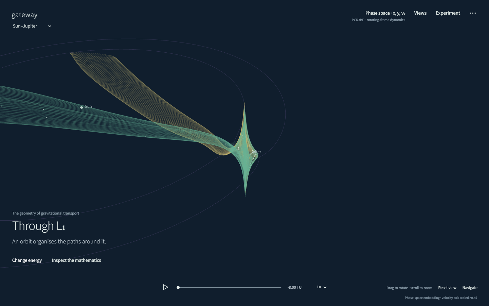
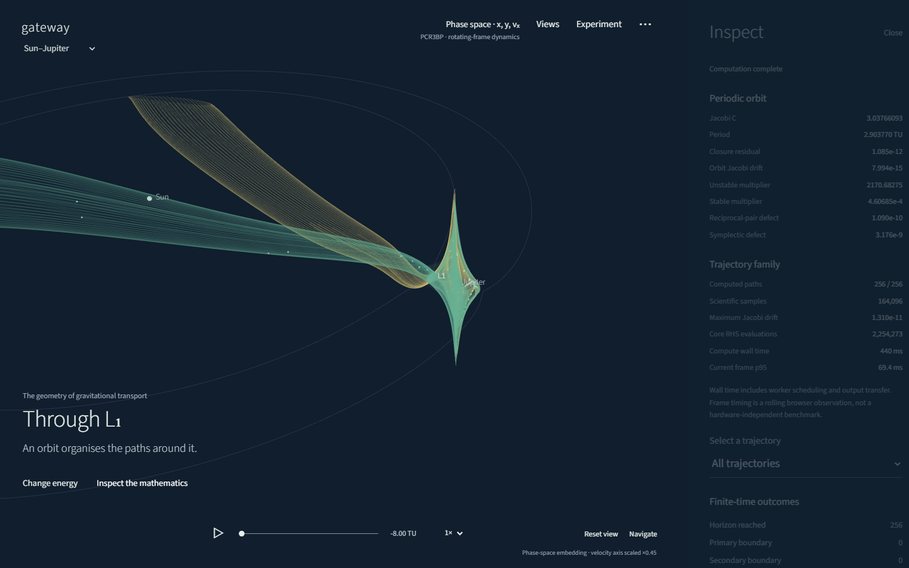

# Gateway

**Explore our Solar System. Follow a world into the geometry of gravitational transport.**

[Live application](https://krishnuni.github.io/gateway/) · [Numerics](docs/NUMERICS.md) · [Validation](docs/VALIDATION.md) · [Architecture](docs/ARCHITECTURE.md)



Gateway is an original scientific computing portfolio project: a Rust numerical engine, compiled to WebAssembly, with a navigable Three.js scene and a React interface. Its trajectory geometry comes from computed dynamics.

## Explore

- Rotate, zoom and pan through the Sun and all eight planets. Focus a planet and scrub the epoch.
- Enter a local Sun–planet laboratory, or the Earth–Moon laboratory.
- Compute L₁/L₂ planar Lyapunov periodic orbits, state transition matrices, a monodromy matrix and stable/unstable manifold seeds.
- Change Jacobi energy, integration horizon, phase count, seed displacement and tolerance.
- Read position, velocity embedding, timestamped inertial histories, potential relief and a linked Poincaré section.
- Release deterministic fixed-energy particle fans; inspect finite-time outcomes, separation and Jacobi error.
- Save experiments locally, export/import JSON recipes, copy reproducible links and export scene images.

Drag to rotate; wheel/pinch to zoom; right-drag/two-finger drag to pan. Space plays or pauses, R resets, +/− zoom. The **Navigate** menu supplies labelled button alternatives.

## Two physical models

The Solar System overview uses **JPL's approximate Keplerian elements for 1800–2050**, with actual three-dimensional orbital inclinations and eccentricities. Distances are in AU; body markers are enlarged. The Earth marker is the Earth–Moon barycentre. The overview is not a coupled N-body integration or a high-precision ephemeris.

Each gateway belongs to the **planar circular restricted three-body problem**: two circular primaries and one massless particle. These computed manifolds belong to the selected idealised model. They are not exact transport tubes of the evolving eight-planet Solar System. Halo orbits, FTLE fields and refined interplanetary transfers are research extensions, not implemented features.

## Run locally

Requires Node.js 24 and Rust with the `wasm32-unknown-unknown` target. A modern browser with WebGL2 and WebAssembly is required. No API key, account or backend is needed.

```sh
npm ci
rustup target add wasm32-unknown-unknown
npm run build:engine
npm run dev
```

For a release build:

```sh
npm run build
npm run preview
```

The WASM module is built from source rather than checked in. Dependency versions are locked in `package-lock.json` and `rust/Cargo.lock`. `rust-toolchain.toml` pins the Rust compiler.

## Verify

```sh
cargo test --manifest-path rust/Cargo.toml
npm test
npm run verify
python -m pip install -r reference/requirements.txt
python reference/validate.py
npx playwright install chromium
npm run test:production
npm run benchmark
```

On Windows the browser tests use installed Microsoft Edge. On Linux they use Playwright Chromium. Production checks mount the actual build under `/gateway/`, including its worker and WASM assets. CI runs numerical, independent SciPy and browser checks before deployment.

The recorded Earth–Moon and Sun–Jupiter L₁/L₂ fixtures agree with independently written SciPy DOP853 calculations to better than **6 × 10⁻¹²** in orbit state over one period. This is a measured result for the recorded fixtures, not an accuracy guarantee for arbitrary trajectories. [Domains, convergence, limitations and raw reports](docs/VALIDATION.md).

## Engineering

The original Rust core contains adaptive Dormand–Prince 5(4) integration, quartic dense output, event localisation, energy-constrained orbit shooting and continuation, variational dynamics, independently estimated hyperbolic eigendirections and transported manifold seeds. A cancellable worker streams owned f64 samples; the renderer rebases and converts them to f32 only for drawing.

Numerical evidence remains inspectable: closure, energy drift, eigenpair residuals, reciprocal-pair and canonical symplectic defects, work counts, termination reasons and stored samples. Finite-time exits are not labelled as proven asymptotic escape.



| Location | Responsibility |
|---|---|
| `rust/src/` | Scientific authority and Solar System model |
| `src/engine/` | WASM ownership, scheduling and cancellation |
| `src/scene/` | Geometry, camera, rendering and playback |
| `src/components/` | Sections, error and separation plots |
| `reference/` | Independent SciPy equations and comparisons |
| `tests/` | Numerical regressions and browser journeys |
| `docs/` | Measured reports, methods and actual screenshots |

## Credits and licence

Original application and numerical implementation; MIT licence. The visual direction takes inspiration from Braintruffle's mathematical films without using their code, imagery or compositions. Documentation separates early design artwork from actual application screenshots.

Model data: [JPL orbital elements](https://ssd.jpl.nasa.gov/planets/approx_pos.html), [JPL astrodynamic parameters](https://ssd.jpl.nasa.gov/astro_par.html) and [JPL three-body conventions](https://ssd-api.jpl.nasa.gov/doc/periodic_orbits.html). [Dependency and method notices](THIRD-PARTY-NOTICES.md).
